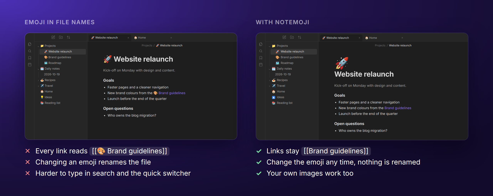
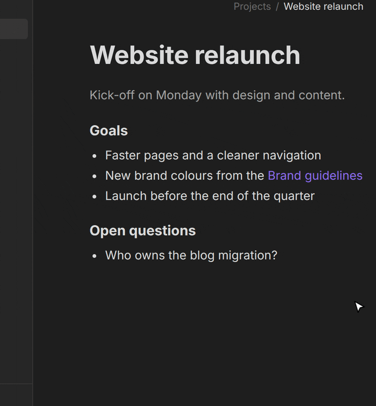
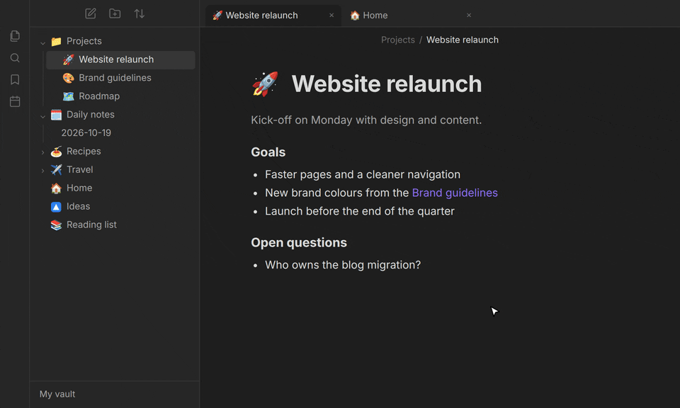
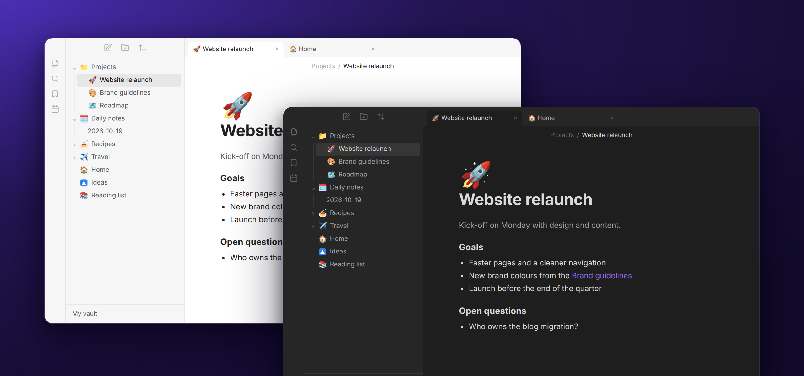

  

<h1 align="center">Notemoji</h1>

  Page icons for Obsidian: give notes, folders and files an emoji or your own image,
  without renaming anything.

## 🤔 Why not just put the emoji in the file name?

- **Your links stay clean.** `[[Brand guidelines]]`, not `[[🎨 Brand guidelines]]`, in every note
  that links to it.
- **Nothing is renamed.** Changing an emoji never renames a file or rewrites links, and other
  apps, Git and your file manager see the same plain names as before.
- **Search and the quick switcher** work with the words you type.
- **Your own images** (logos, project icons) work just like emoji.
- **Your notes are never modified.** Notemoji keeps everything in its own data file.

## ⚒️ Features

### Pick an emoji in two clicks

Right-click any note, folder or file → _Set … emoji_. The emoji appears in the file explorer, in
the tab and, if you like, large above the note title. Click it there to
change it.

### A real emoji picker

Search by name or keyword (`rocket`, `party`, `:tada:`), browse categories, reuse recently used
emoji and choose with the arrow keys and Enter. Pasting any emoji, or using your system's emoji
picker, works too, including flags, skin tones and families (`🇩🇪`, `👍🏽`, `👨‍👩‍👧‍👦`) and symbols
such as `★`.

  

### Your own icons

Upload PNG, JPG, GIF, WebP or SVG images in the picker's _Custom icons_ section and use them just
like emoji.

### The same emoji style everywhere

Keep your system's emoji, or show Notemoji's emoji as Twemoji, OpenMoji, Noto Color Emoji or
black-and-white Noto Emoji on every device. You can also use your own emoji font file.

### Light, dark and mobile

## 🧭 How to use Notemoji

| Action               | How                                                                                         |
| -------------------- | ------------------------------------------------------------------------------------------- |
| Set an emoji         | Right-click a note, folder or file → _Set … emoji_, or run _Set emoji for current note_     |
| Change an emoji      | Click the large emoji above the note title, or right-click → _Change … emoji_               |
| Remove an emoji      | _Remove_ in the picker, right-click → _Remove … emoji_, or _Remove emoji from current note_ |
| Use your own icon    | In the picker's _Custom icons_ section, click the upload tile and choose an image           |
| Delete your own icon | Right-click (or long-press) it in the picker → _Delete custom icon_                         |

## ⚙️ Settings

| Setting                       | Default      | What it does                                                                                            |
| ----------------------------- | ------------ | ------------------------------------------------------------------------------------------------------- |
| Emoji at note title           | Off          | Or _Large, above the title_ (click it to change the emoji), or _Inline, before the title_               |
| Emoji in tab titles           | On           | The emoji in front of each tab's name                                                                   |
| Emoji in view header title    | Off          | The emoji in front of the title in the bar at the top of a tab                                          |
| Emoji style                   | System emoji | Pick a style by its preview: Twemoji, OpenMoji, Noto Color Emoji, Noto Emoji Mono or your own font file |
| Custom icons                  | –            | Shows how many custom icons you have and their size; _Delete all_ removes them                          |
| Picker image cache            | –            | Shows the size of the picker's pre-rendered emoji; _Clear_ deletes them                                 |
| Remove emoji of missing files | –            | Cleans up emoji of notes, folders and files that no longer exist                                        |

## 💻 Installation

- **directly in Obsidian:**
  - Settings → Community plugins → _Browse_ → search for **Notemoji** → _Install_ → **Enable**
- **via GitHub:**
  - Copy `manifest.json`, `main.js` and `styles.css` from the latest release into `<your vault>/.obsidian/plugins/notemoji/`.
  - Reload Obsidian and enable **Notemoji** under _Settings → Community plugins_.

## ❓ FAQ

<b>Where are the emoji stored?</b>

In `.obsidian/plugins/notemoji/data.json`, by the path of each note, folder or file. Renaming or
moving items inside Obsidian keeps their emoji; doing it outside of Obsidian (file manager, Git,
another editor) does not. Deleted items keep their entry, so a restore or a sync brings the emoji
back; _Remove emoji of missing files_ cleans them up.

<b>Do my emoji sync to my other devices?</b>

Yes, if your sync copies plugin settings (with Obsidian Sync: _Installed community plugins_).
Custom icons live in `.obsidian/plugins/notemoji/icons/` and travel the same way.

<b>What does an emoji style change?</b>

Only Notemoji's emoji (explorer, titles, tabs, picker); emoji in your notes stay as they are.
Emoji a style does not contain use your system's emoji. A style is downloaded only when you click
_Download_, once per device; until then, your system's emoji are shown. Downloaded styles are kept
in `.obsidian/plugins/notemoji/fonts/` and _Delete_ removes the ones you do not use. Apple's emoji
may only be used on Apple devices, where Notemoji shows them anyway.

<b>Why does Windows show flags as letters?</b>

Windows' emoji font has no flags (`🇩🇪` shows as `DE`). Any colour emoji style fixes that; the
real emoji is stored either way.

<b>How much space does Notemoji use?</b>

The data file is tiny. The picker keeps pre-rendered images of the emoji in
`.obsidian/plugins/notemoji/cache/` (3–7 MB per style), so it opens and scrolls smoothly; _Clear_
deletes them. Everything is in the plugin folder and is removed with the plugin.

<b>I'm upgrading from Notemoji 1.x. Anything to do?</b>

No, your emoji keep working as they are.

<b>Which emoji are in the picker?</b>

Everything up to Emoji 15.0, which every current system can display. Newer emoji can be pasted.
The large emoji above the title follows Obsidian's _Show inline title_ setting.

## 🌐 Network use

Notemoji works offline. It only connects to the internet when you click _Download_ for an emoji
style, and then downloads exactly that font from GitHub. Each file is pinned to a release and
checked against its SHA-256 checksum before it is used:

- Twemoji: `github.com/mozilla/twemoji-colr` (release v0.7.0, 1.5 MB)
- Noto Color Emoji: `github.com/googlefonts/noto-emoji` (v2.051, 5.0 MB)
- OpenMoji: `github.com/hfg-gmuend/openmoji` (17.0.0, 1.0 MB)
- Noto Emoji: `github.com/google/fonts` (2.0 MB)

## 😎 You might also like some other plugins I've made:

- **[TidyTasks](obsidian://show-plugin?id=tidytasks)** - Automatically move completed tasks to the bottom of each Markdown task list, keeping subtasks attached and surrounding text in place.

My plugins are designed to work across Windows, macOS, Android, and iOS.

## ⚠️ Feedback and support

Found a bug or have a suggestion? Open an issue in this repository's **GitHub Issues** tab. Include your Obsidian version, device/platform, a small Markdown example and what you expected to happen. Please remove private note content before sharing examples. Want to contribute? See [CONTRIBUTING.md](CONTRIBUTING.md).

## 🙏 Credits

Emoji names and keywords come from [Emojibase](https://emojibase.dev) (MIT), based on the
[Unicode CLDR](https://cldr.unicode.org) data. Downloadable emoji styles:
[Twemoji](https://github.com/jdecked/twemoji) by Twitter (CC-BY 4.0, font by
[Mozilla](https://github.com/mozilla/twemoji-colr)),
[Noto Color Emoji and Noto Emoji](https://github.com/googlefonts/noto-emoji) by Google (SIL Open
Font License 1.1) and [OpenMoji](https://openmoji.org) by HfG Schwäbisch Gmünd (CC BY-SA 4.0).
