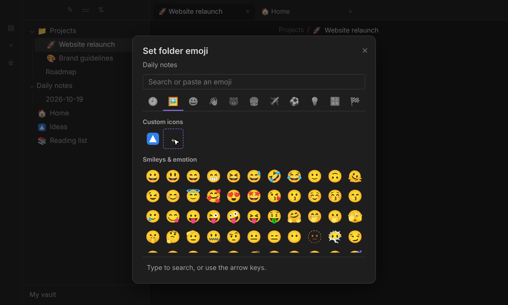

# Notemoji

Give your notes and folders an emoji or your own icon. It shows up in the file
explorer, in tabs, in the title bar and, if you like, above the note title. Your notes are
never modified.


## ⚒️ Features

- **Page icons.** Optionally, a large emoji above the note title. Click it to change it.
- **Everywhere you look.** File explorer, note title, tab titles and the title bar of each tab.
  Every place except the file explorer can be turned off.
- **A real emoji picker.** Search by name or keyword (`rocket`, `party`, `:tada:`), browse
  categories, reuse recently used emoji, use the arrow keys and Enter. Pasting any emoji, or
  using your system's emoji picker, works too.
- **Your notes stay untouched.** Emoji are saved in the plugin's own data file, never in
  your notes, and follow them when you rename or move them in Obsidian.
- **Your own icons.** Upload PNG, JPG, GIF, WebP or SVG images in the picker and use them
  just like emoji.
- **Folders and other files too.** Folders, PDFs, images and canvases can have an emoji as well.
- **Any emoji.** Flags, skin tones, keycaps and family sequences (`🇩🇪`, `👍🏽`, `1️⃣`,
  `👨‍👩‍👧‍👦`) stay intact. Symbols such as `★` or `✓` work as well.

## 🤔 How to use Notemoji

| Action               | How                                                                                         |
| -------------------- | ------------------------------------------------------------------------------------------- |
| Set an emoji         | Right-click a note, folder or file → _Set … emoji_, or run _Set emoji for current note_     |
| Change an emoji      | Click the large emoji above the note title, or right-click → _Change … emoji_               |
| Remove an emoji      | _Remove_ in the picker, right-click → _Remove … emoji_, or _Remove emoji from current note_ |
| Use your own icon    | In the picker's _Custom icons_ section, click the upload tile and choose an image           |
| Delete your own icon | Right-click (or long-press) it in the picker → _Delete custom icon_                         |

<p align="center">
  
  
</p>

## ⚙️ Settings

| Setting                       | Default | What it does                                                                              |
| ----------------------------- | ------- | ----------------------------------------------------------------------------------------- |
| Emoji at note title           | Off     | Or _Large, above the title_ (click it to change the emoji), or _Inline, before the title_ |
| Emoji in tab titles           | On      | The emoji in front of each tab's name                                                     |
| Emoji in view header title    | Off     | The emoji in front of the title in the bar at the top of a tab                            |
| Custom icons                  | –       | Shows how many custom icons you have and their size; _Delete all_ removes them            |
| Remove emoji of missing files | –       | Cleans up emoji of notes, folders and files that no longer exist                          |

## 💻 Installation

- **directly in Obsidian:**
  - Settings → Community plugins → _Browse_ → search for **Notemoji** → _Install_ → **Enable**
- **via GitHub:**
  - Copy `manifest.json`, `main.js` and `styles.css` from the latest release into `<your vault>/.obsidian/plugins/notemoji/`.
  - Reload Obsidian and enable **Notemoji** under _Settings → Community plugins_.

## 💡 Additional info

- **Where emoji are stored:** in `.obsidian/plugins/notemoji/data.json`, by the path of each
  note, folder or file. Renaming or moving items inside Obsidian keeps their emoji; doing it
  outside of Obsidian (file manager, Git, another editor) does not.
- **Deleted items** keep their entry in the data file, so a restore or a sync brings the emoji
  back. _Remove emoji of missing files_ cleans them up.
- **Custom icons** are stored in `.obsidian/plugins/notemoji/icons/`, so they disappear
  together with the plugin when you uninstall it. They reach your other devices if your sync
  copies plugin folders (with Obsidian Sync: _Installed community plugins_). Images are shown
  as they are: a black icon stays black, also in a dark theme.
- **Upgrading from 1.x:** your emoji keep working as they are.
- **The note title emoji** follows Obsidian's _Show inline title_ setting.
- **Emoji look** comes from your operating system's font. Some systems, notably Windows, show
  flags as letters (`🇩🇪` as `DE`); the real emoji is stored either way. The picker lists
  emoji up to Emoji 15.0, which every current system can display; newer ones can be pasted.

## 🛠️ Development

```sh
npm ci
OBSIDIAN_VAULT=/path/to/test/vault npm run dev   # builds into the vault; pair with the Hot Reload plugin
npm run check                                    # format, lint, typecheck, tests and build
npm run demo                                     # re-records the README media
```

## 😎 You might also like some other plugins I've made:

- **[TidyTasks](obsidian://show-plugin?id=tidytasks)** - Automatically move completed tasks to the bottom of each Markdown task list, keeping subtasks attached and surrounding text in place.

My plugins are designed to work across Windows, macOS, Android, and iOS.

## ⚠️ Feedback and support

Found a bug or have a suggestion? Open an issue in this repository's **GitHub Issues** tab. Include your Obsidian version, device/platform, a small Markdown example and what you expected to happen. Please remove private note content before sharing examples.

## 🙏 Credits

Emoji names and keywords come from [Emojibase](https://emojibase.dev) (MIT), based on the
[Unicode CLDR](https://cldr.unicode.org) data.
