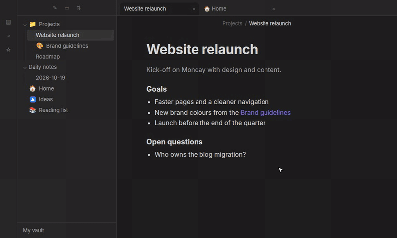
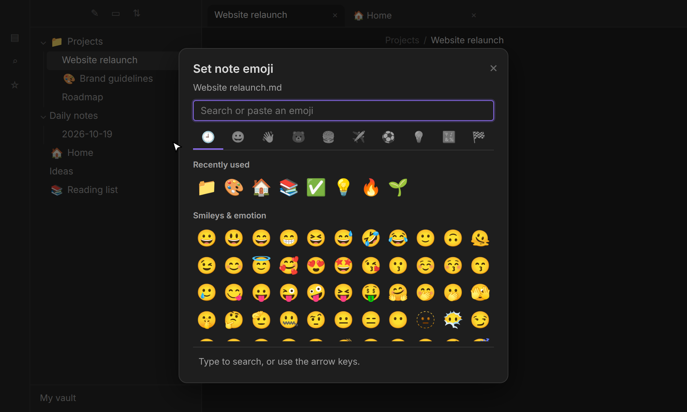
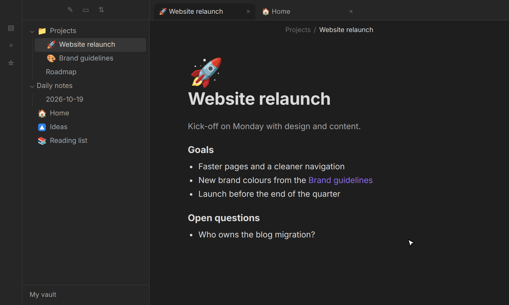

# Notemoji

Give your notes and folders an emoji. It shows up in the file
explorer, above the note title, in tabs and in the title bar, and it stays with the note
wherever the note goes.



## ⚒️ Features

- **Page icons.** Optionally, a large emoji above the note title. Click it to change it.
- **Everywhere you look.** File explorer, note title, tab titles and the title bar of each tab.
  Every place except the file explorer can be turned off.
- **A real emoji picker.** Search by name or keyword (`rocket`, `party`, `:tada:`), browse
  categories, reuse recently used emoji, use the arrow keys and Enter. Pasting any emoji, or
  using your system's emoji picker, works too.
- **The emoji lives in the note.** A note's emoji is saved as the `icon` property in its
  frontmatter. It survives renaming and moving the file anywhere (also in your file manager,
  Git or another editor), syncs with the note and works with Bases and Dataview.
- **Folders and other files too.** Folders, PDFs, images and canvases can have an emoji as well.
- **Any emoji.** Flags, skin tones, keycaps and family sequences (`🇩🇪`, `👍🏽`, `1️⃣`,
  `👨‍👩‍👧‍👦`) stay intact. Symbols such as `★` or `✓` work as well.

## 🤔 How to use Notemoji

| Action                  | How                                                                                         |
| ----------------------- | ------------------------------------------------------------------------------------------- |
| Set an emoji            | Right-click a note, folder or file → _Set … emoji_, or run _Set emoji for current note_     |
| Change an emoji         | Click the large emoji above the note title, or right-click → _Change … emoji_               |
| Remove an emoji         | _Remove_ in the picker, right-click → _Remove … emoji_, or _Remove emoji from current note_ |
| Edit it by hand         | Change the `icon` property of the note in the Properties panel                              |
| Give new notes an emoji | Add `icon: 📝` to the frontmatter of your template                                          |

<p align="center">
  
  
</p>

## ⚙️ Settings

| Setting                        | Default | What it does                                                                              |
| ------------------------------ | ------- | ----------------------------------------------------------------------------------------- |
| Emoji at note title            | Off     | Or _Large, above the title_ (click it to change the emoji), or _Inline, before the title_ |
| Emoji in tab titles            | On      | The emoji in front of each tab's name                                                     |
| Emoji in view header title     | On      | The emoji in front of the title in the bar at the top of a tab                            |
| Move note emoji to frontmatter | –       | Only shown after upgrading from 1.x, see below                                            |
| Remove emoji of missing files  | –       | Cleans up emoji of folders and files that no longer exist                                 |

## 💻 Installation

- **directly in Obsidian:**
  - Settings → Community plugins → _Browse_ → search for **Notemoji** → _Install_ → **Enable**
- **via GitHub:**
  - Copy `manifest.json`, `main.js` and `styles.css` from the latest release into `<your vault>/.obsidian/plugins/notemoji/`.
  - Reload Obsidian and enable **Notemoji** under _Settings → Community plugins_.

## 💡 Additional info

- **Where emoji are stored:** notes in their `icon` property; folders and other files (which
  have no frontmatter) in the plugin's data file. Renaming or moving those inside Obsidian
  keeps their emoji; doing it outside of Obsidian does not.
- **Deleted folders and files** keep their entry in the data file, so a restore or a sync
  brings the emoji back. _Remove emoji of missing files_ cleans them up.
- **Existing `icon` properties** that are not an emoji (for example from other icon plugins) are ignored,
  and Notemoji asks before replacing one.
- **Upgrading from 1.x:** your emoji keep working. A note's emoji moves into its frontmatter
  the next time you change it, or all at once with _Move note emoji to frontmatter_.
- **The note title emoji** follows Obsidian's _Show inline title_ setting.
- **Emoji look** comes from your operating system's font. Some systems, notably Windows, show
  flags as letters (`🇩🇪` as `DE`); the real emoji is stored either way. The picker lists
  emoji up to Emoji 15.0, which every current system can display; newer ones can be pasted.

## 🛠️ Development

```sh
npm ci
OBSIDIAN_VAULT=/path/to/test/vault npm run dev   # builds into the vault; pair with the Hot Reload plugin
npm run check                                    # format, lint, typecheck, tests and build
npm run demo                                     # re-records the README media
```

## 😎 You might also like some other plugins I've made:

- **[TidyTasks](obsidian://show-plugin?id=tidytasks)** - Automatically move completed tasks to the bottom of each Markdown task list, keeping subtasks attached and surrounding text in place.

My plugins are designed to work across Windows, macOS, Android, and iOS.

## ⚠️ Feedback and support

Found a bug or have a suggestion? Open an issue in this repository's **GitHub Issues** tab. Include your Obsidian version, device/platform, a small Markdown example and what you expected to happen. Please remove private note content before sharing examples.

## 🙏 Credits

Emoji names and keywords come from [Emojibase](https://emojibase.dev) (MIT), based on the
[Unicode CLDR](https://cldr.unicode.org) data.
