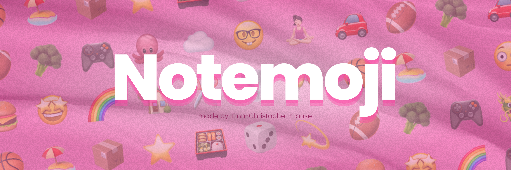
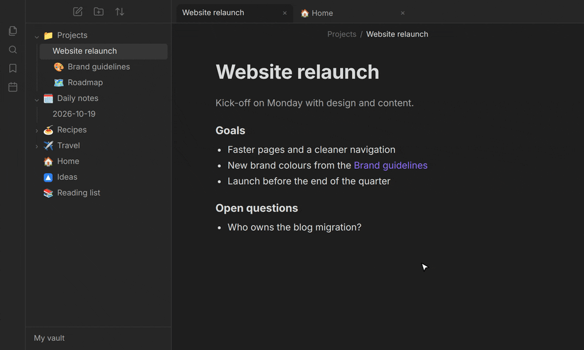
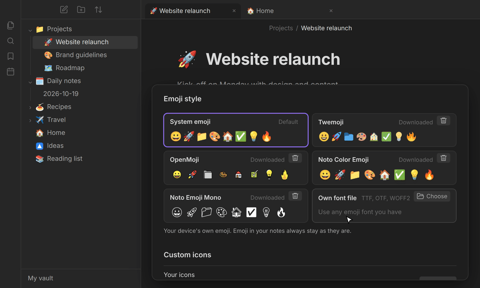
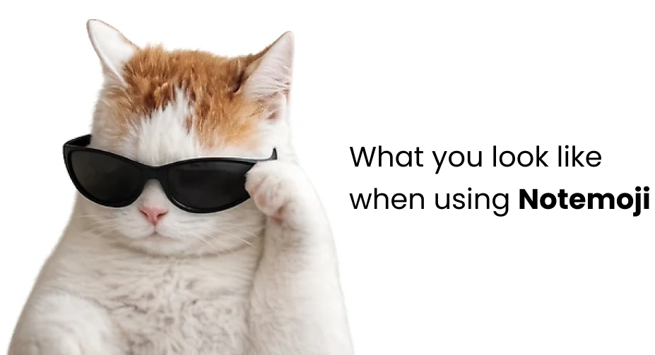

**Assign emoji icons to notes and folders in the file explorer to make your vault feel a little cozier.**

## 🖱️ How to use

- Right-click a note, folder or file in the file explorer → **Set emoji**.
- Search the full emoji picker by name, keyword or shortcode, browse categories and recent emoji, or paste any emoji directly.
- Use the arrow keys to navigate the picker and press Enter to select an icon.
- Choose between emoji, your own uploaded images and Obsidian's built-in icons.
- Right-click the item again to change or remove its icon.
- You can also set or remove the icon of the active note from the command palette.

## 💡 Additional info

- Icons can be shown in the file explorer, note titles, tabs, view headers and next to internal links. You can choose exactly where they appear in the settings.
- Choose from the full emoji picker, upload your own image icons, use Obsidian's built-in icons, and customize the appearance with system emoji, Twemoji, OpenMoji, Noto Color Emoji, Noto Emoji Mono or your own emoji font.
- Notemoji can optionally assign a suitable emoji to newly created notes based on their names. This is disabled by default and currently supports English and German note names.
- Icons are display-only. Notemoji never modifies note names or note contents.
- Icons stay assigned when notes, files or folders are renamed or moved inside Obsidian.
- Deleted paths are retained to avoid losing assignments during synchronization. Entries for files that no longer exist can be removed manually in the settings.

## 💻 You might also like some other plugins I've made:

- **[TidyTasks](obsidian://show-plugin?id=tidytasks)** - Automatically move completed tasks to the bottom of each Markdown task list, keeping subtasks attached and surrounding text in place.
- **[Cloudboard](obsidian://show-plugin?id=cloudboard)** - Create Pinterest-style image boards with both local and online images, without requiring the use of Obsidian Canvas.

Thank you for using my plugins and supporting my work! My plugins are designed to work across Windows, macOS, Android, and iOS.

## ⚠️ Feedback and support

Found a bug or have a suggestion? Open an issue in this repository's **GitHub Issues** tab. Include your Obsidian version, device/platform, a small Markdown example and what you expected to happen. Please remove private note content before sharing examples.

Thanks for using my plugins and supporting my work! - Finn

