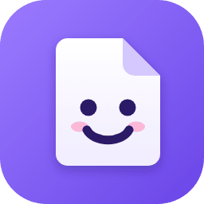
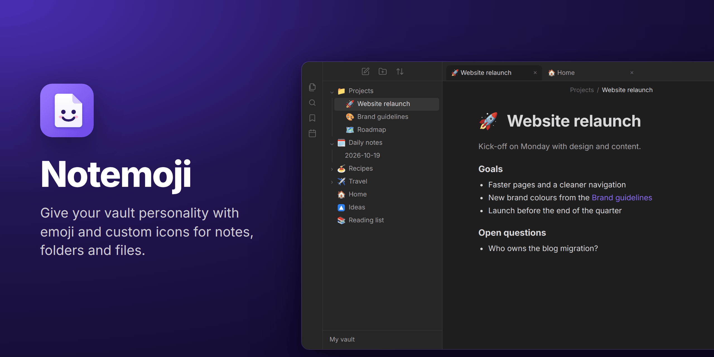
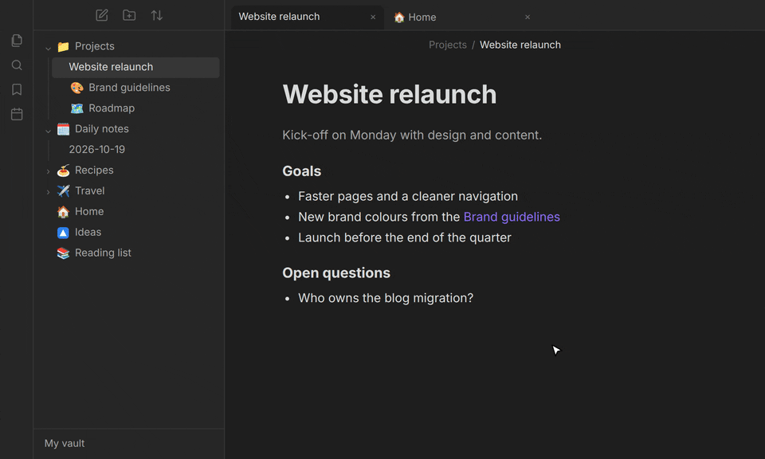
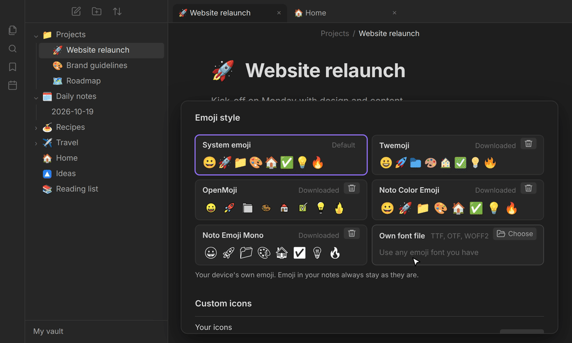
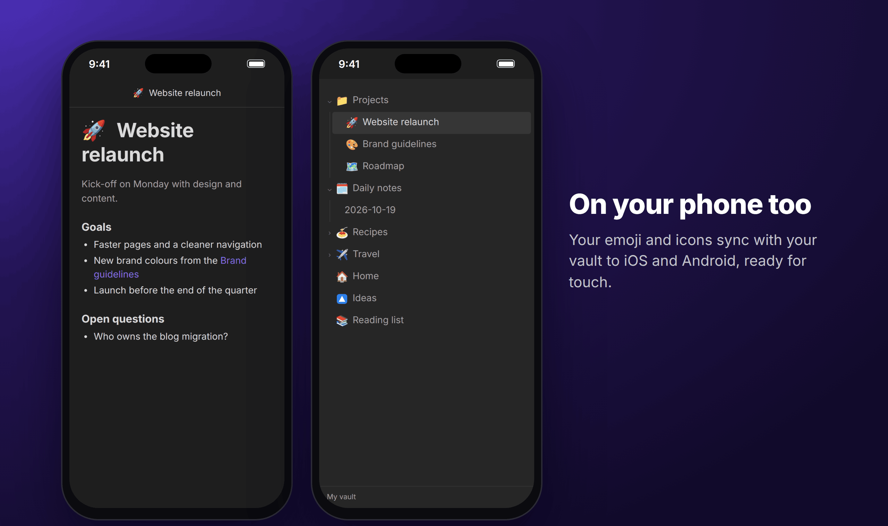
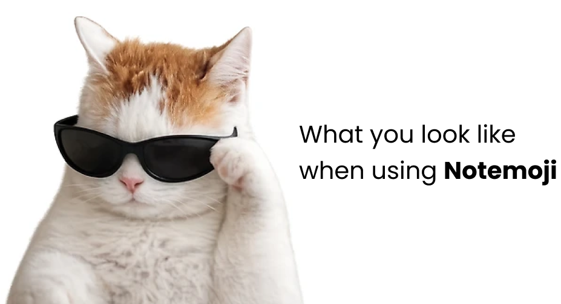

  

<h1 align="center">Notemoji</h1>

  <b>Assign emoji and your own icons to notes, folders and files to make your vault feel a little cozier.</b>

## 🖱️ How to use

- Simply right-click the item in the file explorer → **Set / Change / Remove … emoji**
- On your phone, long-press instead. The commands **Set emoji for current note** and **Remove emoji from current note** work too.
- In the picker, search by name, keyword or shortcode (`rocket`, `party`, `:tada:`), upload your own image under **Custom icons**, or pick one of the **Obsidian icons** after the emoji.
- You can also change a note's emoji by clicking the large emoji above its title (if shown), and remove it with **Remove** in the picker.
- To delete one of your own icons, right-click (or long-press) it in the picker → **Delete custom icon**, or use the settings.

## 💡 Additional info

- Icons are shown in the **file explorer**, in **tabs** and at the **note title**. Turn on _Emoji next to links_, and links in your notes show them too.
- A full emoji picker with every emoji up to Emoji 15.0 and your recently used emoji at the top. Your operating system's emoji picker (Windows: `Win + .`, macOS: `Control + Command + Space`) and pasting work too.
- Multi code point emoji are supported: flags, skin tones, variation selectors, keycaps and ZWJ families.
- **Your own icons:** PNG, SVG, GIF, WebP, AVIF or JPG images, such as logos or project icons. They stay sharp on any screen and work just like emoji. Obsidian's own line icons are in the picker too.
- Emoji come from your operating system, or from an emoji style you choose: Twemoji, OpenMoji, Noto Color Emoji, black-and-white Noto Emoji or any emoji font file you have.
- Turn on _Automatic emoji for new notes_, and each note you create gets a fitting emoji by itself.
- Icons stay with their note, also if renamed or moved. A deleted item keeps its emoji, so a restore or a sync brings it back; _Remove emoji of missing files_ cleans them up.
- Your icons are saved in Obsidian's plugin data and never touch the content of your notes. They sync with your vault, also to iOS and Android.

## ❓ FAQ

<b>Where are the emoji stored? Are my notes changed?</b>

Your notes are never changed. Emoji are stored in
<code>.obsidian/plugins/notemoji/data.json</code>, by the path of each note, folder or file.
Renaming or moving items inside Obsidian keeps their emoji; doing it outside of Obsidian (file
manager, Git, another editor) does not. Deleted items keep their entry, so a restore or a sync
brings the emoji back; <em>Remove emoji of missing files</em> cleans them up. Each device also keeps
a copy, <code>backup.json</code>, which repairs <code>data.json</code> if it gets damaged.

<b>Do my emoji sync to my other devices?</b>

Yes, if your sync copies plugin settings (with Obsidian Sync: <em>Installed community
plugins</em>). Custom icons are stored in the same <code>data.json</code>, so they always travel
together with your emoji. Obsidian icons are saved there as a small copy, so they look the same on
every device, also where Obsidian is older or newer and draws an icon differently or doesn't have
it. Keep Notemoji up to date on all your devices. From version 2.0 on, an outdated version shows a
notice and stops saving instead of overwriting newer data.

<b>How many custom icons can I have? Why are some images refused?</b>

Custom icons can use up to 3 MB, room for at least 50 icons and usually many more; the settings
show how much is used. The copies of Obsidian icons you use count too, at about 1 KB each. The limit
keeps <code>data.json</code> well below the 5 MB that Obsidian Sync (Standard plan) syncs per file.
Images are scaled down to 512 pixels, sharp even on very dense screens, and SVGs stay vectors.
Refused, with the reason shown: HEIC photos (convert them to JPG or PNG), files over 20 MB, SVGs
over 45 KB, animated images over 512 pixels or 45 KB, and images with so much detail that they don't
fit even at lower quality.

<b>What does an emoji style change?</b>

Only Notemoji's emoji (explorer, titles, tabs, picker); emoji in your notes stay as they are.
Emoji a style does not contain use your system's emoji. A style is downloaded only when you click
<em>Download</em>, once per device; until then, your system's emoji are shown. Downloaded styles are
kept in <code>.obsidian/plugins/notemoji/fonts/</code> and <em>Delete</em> removes the ones you do
not use. Apple's emoji may only be used on Apple devices, where Notemoji shows them anyway.

<b>Why does Windows show flags as letters?</b>

Windows' emoji font has no flags (<code>🇩🇪</code> shows as <code>DE</code>). Any colour emoji
style fixes that; the real emoji is stored either way.

<b>Why don't I see the emoji at the note title?</b>

It is shown before the title while Obsidian's <em>Show inline title</em> setting (Appearance) is
on. Under <em>Emoji at note title</em> you can make it large, above the title, or turn it off.

<b>How does the automatic emoji for new notes choose?</b>

With <em>Automatic emoji for new notes</em> on, each note you create on this device gets an emoji
from its name: the obvious one for a word like <code>pizza</code> (🍕) or <code>dentist</code> (🦷),
one of a few fitting emoji for a word like <code>trip</code> (✈️, 🧳, 🗺️ …), otherwise one that suits
any note (📝, 💡, 🌱 …). A new <em>Untitled</em> note gets its emoji once you've named it. Your own
emoji always win: notes that have one are never changed, and you can change or remove the automatic
one like any other (it is not added to your recently used emoji). Notes that arrive by sync or
import are normally left alone. Words are recognised in English, and also in German when Obsidian
(1.8.7 or newer) is set to German.

<b>Which emoji are in the picker?</b>

Everything up to Emoji 15.0, which every current system can display. Newer emoji can be pasted.
After the emoji come Obsidian's own icons, as many as your version of Obsidian has.

## 🌐 Network use

Notemoji works offline. It only connects to the internet when you click _Download_ for an emoji
style, and then downloads exactly that font from GitHub. Each file is pinned to a release (or a
fixed commit) and checked against its SHA-256 checksum before it is used:

- Twemoji: `github.com/mozilla/twemoji-colr` (release v0.7.0, 1.5 MB)
- Noto Color Emoji: `github.com/googlefonts/noto-emoji` (v2.051, 5.0 MB)
- OpenMoji: `github.com/hfg-gmuend/openmoji` (17.0.0, 1.0 MB)
- Noto Emoji: `github.com/google/fonts` (2.0 MB)

## 🙏 Credits

Emoji names and keywords come from [Emojibase](https://emojibase.dev) (MIT), based on the
[Unicode CLDR](https://cldr.unicode.org) data. Downloadable emoji styles:
[Twemoji](https://github.com/jdecked/twemoji) by Twitter (CC-BY 4.0, font by
[Mozilla](https://github.com/mozilla/twemoji-colr)),
[Noto Color Emoji and Noto Emoji](https://github.com/googlefonts/noto-emoji) by Google (SIL Open
Font License 1.1) and [OpenMoji](https://openmoji.org) by HfG Schwäbisch Gmünd (CC BY-SA 4.0).
Obsidian icons are [Lucide](https://lucide.dev) icons (ISC), which come with Obsidian.

## 💻 You might also like some other plugins I've made:

- **[TidyTasks](obsidian://show-plugin?id=tidytasks)** - Automatically move completed tasks to the bottom of each Markdown task list, keeping subtasks attached and surrounding text in place.

Thank you for using my plugins and supporting my work! My plugins are designed to work across Windows, macOS, Android, and iOS.

## ⚠️ Feedback and support

Found a bug or have a suggestion? Open an issue in this repository's **GitHub Issues** tab. Include your Obsidian version, device/platform, a small Markdown example and what you expected to happen. Please remove private note content before sharing examples. Want to contribute? See [CONTRIBUTING.md](https://github.com/finnxwz/notemoji/blob/main/CONTRIBUTING.md).

Thanks for using my plugins and supporting my work! - Finn

